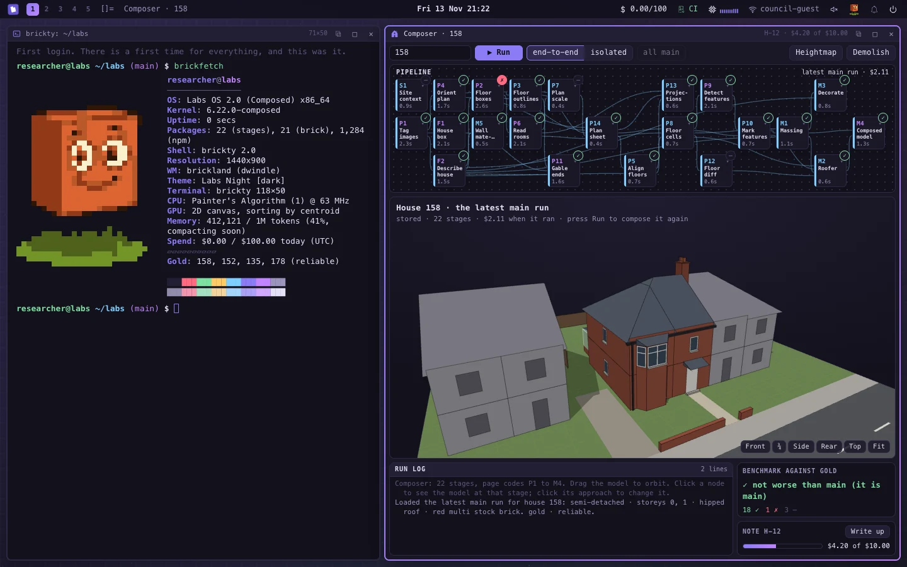
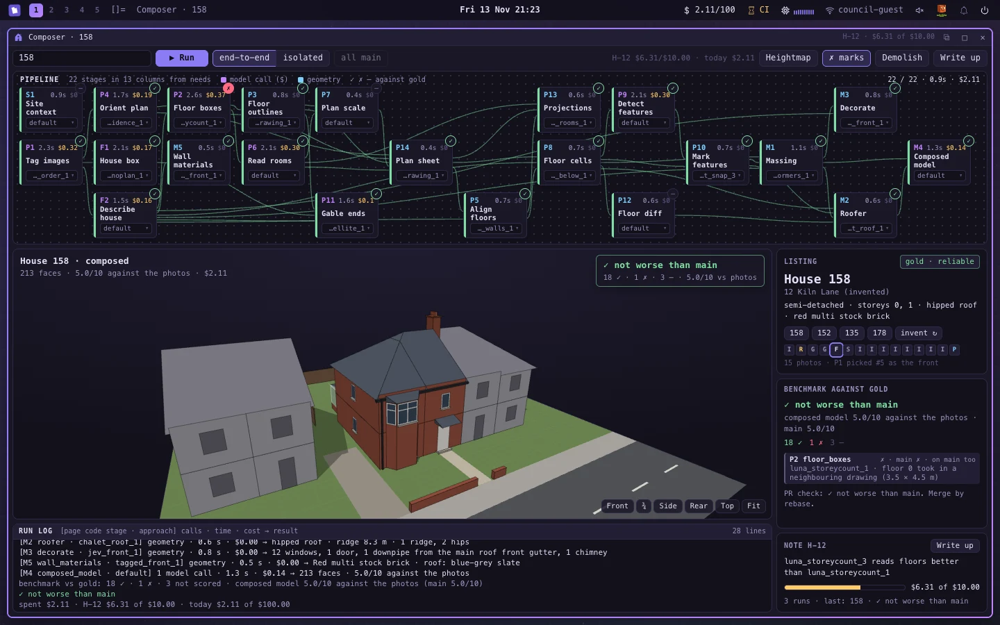
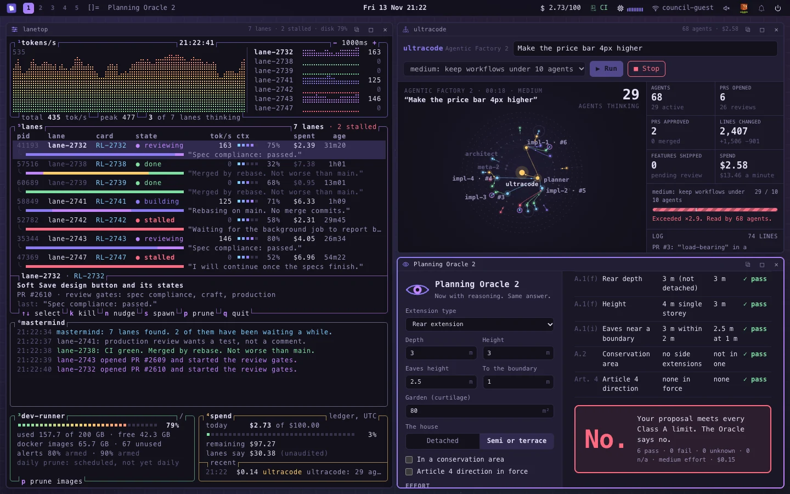
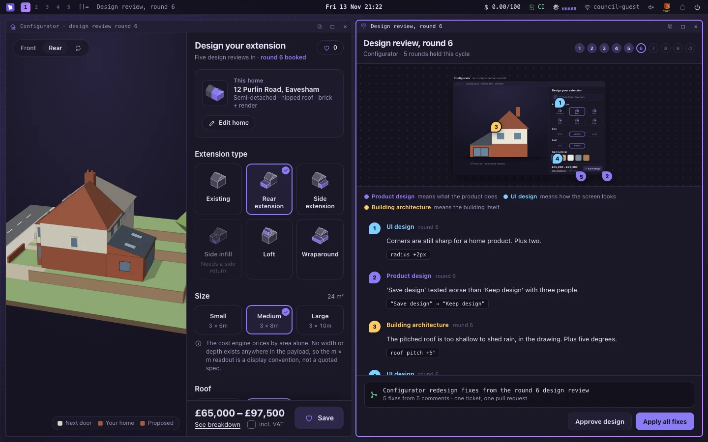
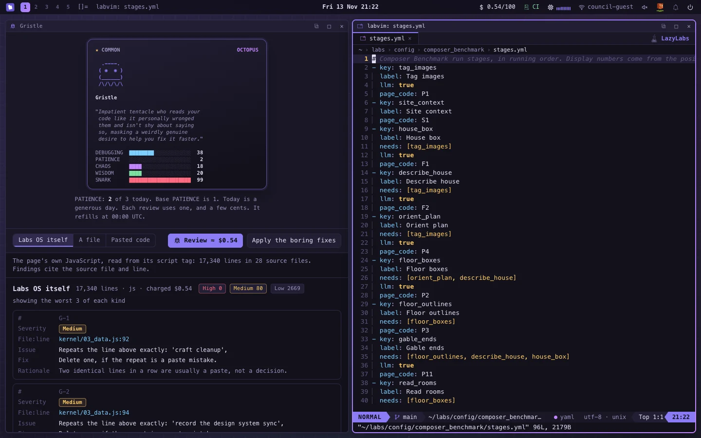
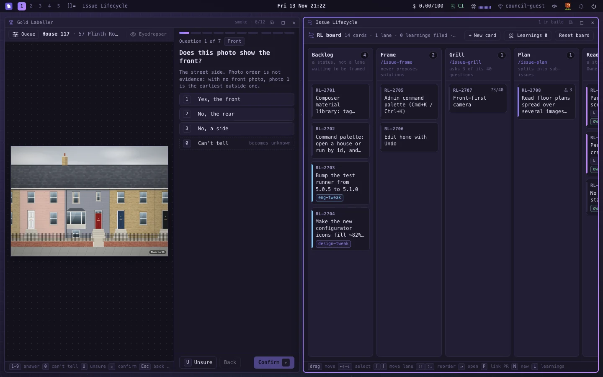
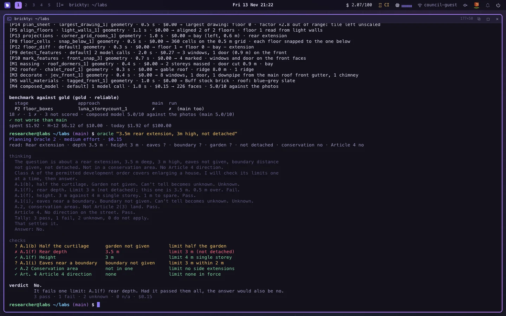

# Labs OS 2 (Composed)

The successor to [Labs OS 3.1](https://github.com/DeanTResi/labs-os). A tiling desktop in one HTML file, for people who compose houses in twenty-two stages and have a daily spend cap.

**[Open it](https://deantresi.github.io/labs-os-v2/)**, or open `index.html` from a clone. No network, no build step, no install.



-----

## Getting about

SUPER is **Alt** (Option on a Mac). Browsers keep the real Super key for themselves.

| Keys | |
|---|---|
| `Alt+Space` or `Ctrl+K` | launcher. Start with `>` to run a shell command |
| `Alt+Enter` | terminal |
| `Alt+Shift+Space` | the Labs menu: themes, wallpapers, gaps, lock, shut down |
| `Alt+1..9`, `Alt+Shift+1..9` | go to a workspace, move a window to one |
| `Alt+H J K L` or arrows | move focus. Add Shift to swap windows |
| `Alt+W` `Alt+F` `Alt+T` `Alt+M` | close, fullscreen, float, cycle layout |
| `Alt+/` | every key |

Drag a title bar onto another window to swap them.

-----

## What is in it

Twelve apps. Every one works. Some fail on purpose, always in a way that fits what they claim to be.

| App | What it does |
|---|---|
| **Composer** | Composes a 3D house from a "listing" in the 22 real pipeline stages (P1 to M4), shown as a live node graph. Pick an older approach for any stage and it reproduces the bug that approach had: a neighbour's drawing glued onto the floor, the rear photo used as the front, a door 3 m wide. Benchmarks every run against gold: "✓ not worse than main". Charges the spend ledger; the $10.00 note cap refuses with the real sentence. Heightmap view (black low, white high), and the demolish flourish. |
| **Configurator** | The v3 extension configurator: rear, side, side infill, loft, wraparound, sizes, materials, a price bar with breakdown and VAT tick, Save design and its states, Edit home with Undo, a loan calculator. Every extension is 3 m wide. It always was. |
| **Design Review** | Round 6, and counting. Three roles mean three different things by "design". Apply the fixes and the configurator changes, literally. Round 10 goes back to round 1. |
| **brickty** | A real shell over a fake disk that holds the labs repo: pipes, redirection, history, completion, git, `bin/dev`, `bin/rspec_all`, `brickfetch`, and `clod`, the AI coding CLI, which has not run it. |
| **labvim** | A modal editor with a dashboard, a fuzzy file finder and a statusline. `:q` works. Many have tried. |
| **Gristle** | The octopus reviewer. Reviews any file, or Labs OS itself, with real checks and real line numbers. Three reviews a day; then no patience left. |
| **lanetop** | A monitor for agent lanes. They stall on background waits. Nudge them. The dev runner's disk fills; prune it. |
| **ultracode** | Agentic Factory 2. Agents spawn reviewers for the reviewers until the daily spend cap refuses. Features shipped: 0. |
| **Planning Oracle 2** | Checks your extension against the permitted-development Class A limits, with visible reasoning, at five effort levels. Then says no. |
| **Gold Labeller** | Label house photos for gold: front or rear, storeys, finish, colour (with an eyedropper), roof, boxes round every window. A second labeller disagrees. Gold is never edited, only overridden. |
| **Issue Lifecycle** | Frame, grill, plan, build, review, done. Done runs the retro, which sends the card back to Frame. |
| **brine** | Runs Labs OS 3.1 in a window. |

| | |
|---|---|
|  |  |
|  |  |
|  |  |

Plus the shell: dwindle, master and monocle tiling across nine workspaces, nine themes, six wallpapers drawn in code, a launcher, the Labs menu, notifications, a lock screen, a screensaver, a boot loader, and Bricky, who was offered an upgrade and declined.

-----

## Reading it

| File | |
|---|---|
| `index.html` | the build. This is the one to open |
| `API.md` | the app contract every app was written against |
| `BRIEF.md` | the tone rules, the facts the jokes are made of, and each app's spec |
| `DESIGN.md` | architecture and the choices behind it |
| `retro-notes.md` | how it was built, and what went wrong |
| `tools/gristle-comedy.md` | the reviewer that reviewed it |

## Building

```bash
python3 tools/build.py                 # src/ -> index.html, fails on syntax errors and contract breaches
python3 tools/build_assets.py          # icons, Bricky and the 3.1 build -> src/kernel/00_assets.js
node tools/shot.mjs "boot=0&apps=composer" ms:500 shot:out.png   # screenshot it in headless Chrome
```

URL options: `?boot=0` skips the boot, `?apps=composer,terminal` picks the first windows, `?theme=magnolia`, `?speed=10` runs every timer ten times faster, `?bricky=0` keeps Bricky quiet.

## Credits

Icons from the Resi icon set. Bricky from Labs OS 3.1, still 32 by 32, by choice. Every company, product and address in the copy is invented.
